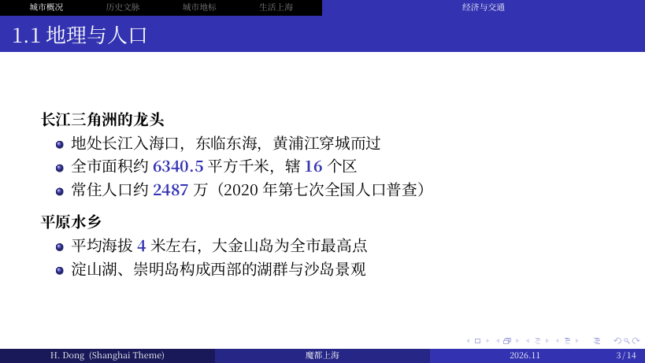
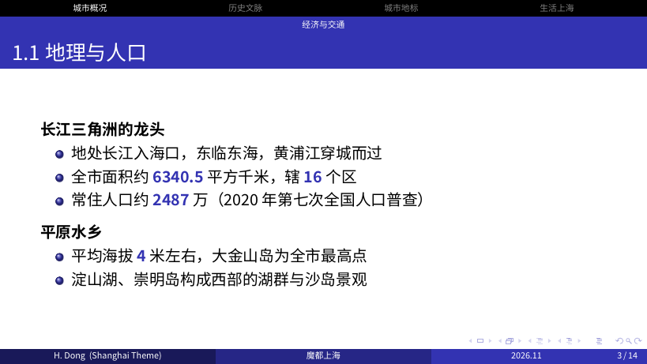
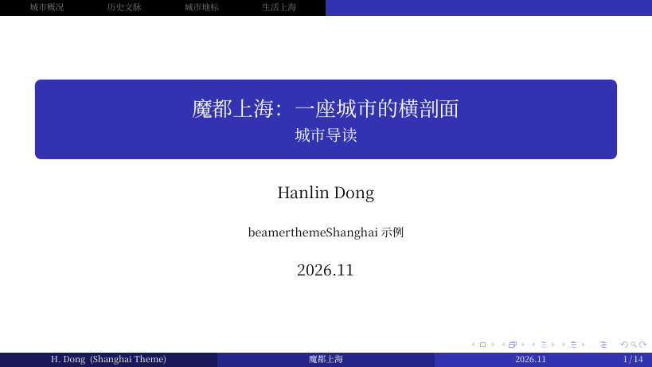
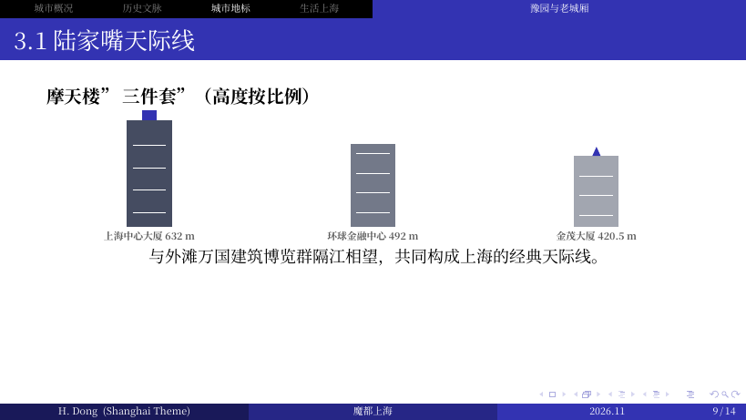
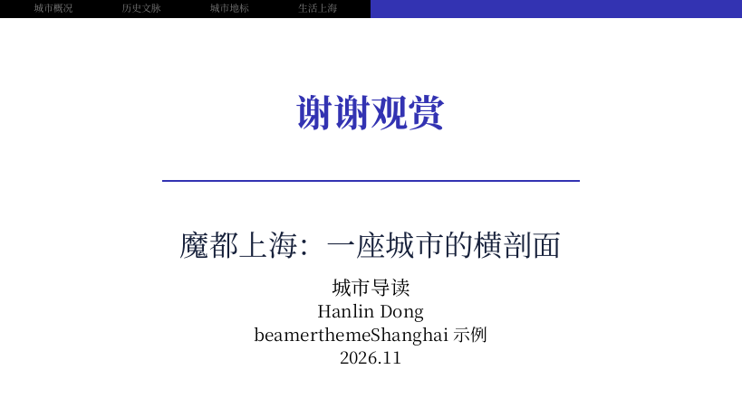

# beamerthemeShanghai 🏙

A clean Beamer theme tuned for **Chinese academic presentations** — defense
slides, project reviews, course reports. 16:9, dense single-page layouts,
image-heavy pages, zero-overfull discipline.

中文答辩、职称评审、课程汇报类 Beamer 主题：等宽居中的顶部导航、无圆点、
带内边距的圆角块、Madrid 式三段底栏，并为中文字体内置了自动回退链。

| 默认导航（左右分栏） | 分行导航 `splitnavigation=true` |
|---|---|
|  |  |

| 封面 | 天际线示例页 | 结束页 |
|---|---|---|
|  |  |  |

## Features / 特性

- **顶部导航**：section 与 subsection 等宽居中排布，无 mini-frame 圆点；
  默认左右分栏（section 左、subsection 右），可用选项改为上下两行。
- **中文字体自动回退**：宋体 / 黑体 / 楷体三条字体链，取本机第一个存在的字体，
  链尾以 TeX Live 自带的 Fandol 字体兜底——装好 TeX Live 即可编译，无需手工配字体。
- **块内边距调优**：圆角块文字与边框之间有呼吸感，适合高密度内容页。
- **Madrid 式底栏**：作者（单位）/ 短标题 / 日期 + 总页码。

## Quick start / 快速上手

```bash
git clone https://github.com/<you>/beamertheme-shanghai.git
cd beamertheme-shanghai/example
latexmk -g -xelatex -interaction=nonstopmode example-shanghai.tex
```

把 `beamerthemeShanghai.sty` 放到你的 `.tex` 同目录（或 `TEXINPUTS` 可见处），
用 **XeLaTeX** 编译：

```latex
\documentclass[aspectratio=169,11pt]{ctexbeamer}
\usetheme{Shanghai}
...
```

## Theme options / 主题选项

```latex
\usetheme{Shanghai}                        % 默认：思源宋体 + 左右分栏导航
\usetheme[font=sans]{Shanghai}             % 黑体为主字体
\usetheme[font=kai]{Shanghai}              % 楷体为主字体（自动开启伪粗体）
\usetheme[font=none]{Shanghai}             % 不动任何字体（交给 ctex 配置）
\usetheme[splitnavigation=true]{Shanghai}  % section / subsection 分两行
```

运行时切换（限导言区）：

```latex
\ShanghaiFontFamily{kai}
```

### Font fallback chains / 字体回退链

| 选项 | 回退链（取第一个本机存在的字体） |
|---|---|
| `serif`（默认） | Source Han Serif SC → Noto Serif CJK SC → Songti SC → STSong → SimSun → **FandolSong**（TeX Live） |
| `sans` | Source Han Sans SC → Noto Sans CJK SC → PingFang SC → Hiragino Sans GB → Microsoft YaHei → SimHei → **FandolHei**（TeX Live） |
| `kai` | Kaiti SC → STKaiti → KaiTi → 楷体 → AR PL UKai CN → LXGW WenKai → **FandolKai**（TeX Live） |

要求：**XeLaTeX**（或兼容的 fontspec 引擎）+ `ctexbeamer`（CJK 支持）。
想完全控制字体就用 `font=none`，之后自行 `\setmainfont` / `\setCJKmainfont`。

## Utility macros / 实用宏（示例中定义）

示例文稿展示了在高密度学术 deck 中常用的几个宏，可直接抄走：

- `\PlainHeading{...}` / `\CompactHeading{...}` — 无框加粗小标题（主要内容不用圆角框）；
- `\EmphNum{...}` — 关键数字强调（加粗 + 主题蓝）；
- `\PhotoCaption{...}` — 图片小字题注；
- `\SectionDivider{n}{章名}` — 深底章节分隔页。

## Recommendations / 实践建议

- **零溢出**：交付前保证 log 中 `Overfull` 为 0；图片宽度在 `\fcolorbox` 内要
  减去边框与内边距（见示例的 `\PhotoPlaceholder`）。
- **放映**：`\hypersetup{pdfpagemode=FullScreen}` 可让 PDF 打开即全屏
  （Acrobat / WPS / Foxit 支持；macOS 预览会忽略）。不要依赖 `/Dur` 定时翻页——
  beamer 会在每帧开始时清空它，且多数阅读器不支持。
- **字体嵌入**：XeLaTeX 默认子集嵌入，`pdffonts` 全部 `emb=yes`，换设备显示一致。

## Requirements / 环境

- TeX Live 2023+（`latexmk`、`fontspec`、Fandol 字体随附）
- `ctex` 宏包（中文支持）
- 思源宋体 / 思源黑体（可选；缺失时自动回退）

## License / 许可

[MIT](LICENSE) © Hanlin Dong
